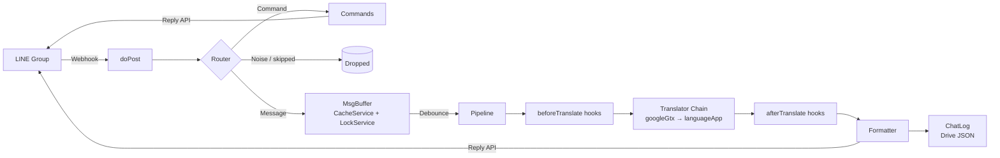

# akai-ito（赤い糸）

**English** | [繁體中文](README.zh-TW.md)

> A real-time translation bot for LINE group chats that lets Chinese and Japanese speakers talk naturally in the same conversation.


-F7DF1E)


---

## Table of Contents

- [Overview](#overview)
- [Features](#features)
- [Architecture](#architecture)
- [Project Structure](#project-structure)
- [Development](#development)
- [Getting Started](#getting-started)
- [Configuration](#configuration)
- [Group Commands](#group-commands)
- [Extending](#extending)
- [Known Limitations](#known-limitations)
- [Privacy](#privacy)
- [Roadmap](#roadmap)

---

## Overview

akai-ito is a LINE Messaging API bot deployed on Google Apps Script. Once added to a group, it determines the translation direction (Chinese ⇄ Japanese) from the sender's role, batches consecutive messages over a short window, and replies with a single translation.

The bot follows a **first-person design**: it is the owner's own communication tool. The bound user is the *owner*, and every other group member is treated as the *partner*.

It requires no paid API and no self-hosted server. The translation layer is abstracted behind a swappable interface, so it can later move to a self-hosted LLM without changes to the rest of the system.

## Features

- **Bidirectional translation**: owner messages are translated into Japanese; partner messages into Traditional Chinese.
- **Message batching**: consecutive messages are collected with a debounce, and consecutive messages from the same person are merged into one translated segment to keep the chat clean.
- **Reply API only**: never uses the Push API, so it does not consume the official account's message quota.
- **Glossary**: common phrases and interjections are translated from a fixed table, and known machine-translation mistakes (forms of address, the bot's name, invented subjects) are corrected after translation.
- **Translator fallback chain**: when the primary translator fails, only the failed segments are passed to the next translator.
- **Noise filtering**: stickers, emoji-only messages, `www`, `笑`, and similar are skipped; messages starting with `!` are skipped on request.
- **Group allowlist**: serves only the single bound group.
- **Runtime tuning**: batching delays can be adjusted with a group command, without redeploying.
- **Conversation logging**: every translated segment (and skipped message) is appended to a JSON file in Google Drive after each reply, with latency metrics — a ready-to-use dataset.

## Architecture



### Message Batching (Debounce)

Apps Script has no long-running process, so timers are not available. akai-ito instead uses a **last-writer-flushes** strategy:

1. Each incoming message is appended to a shared buffer inside a lock and receives an increasing sequence number.
2. The execution waits `quietMs`. If the oldest buffered message is about to exceed `maxWaitMs`, the wait is shortened automatically.
3. On waking, it checks again under the lock:
   - If it is still the **latest message**, or the **oldest message has waited longer than `maxWaitMs`**, it takes the whole batch, clears the buffer, and replies with its own reply token.
   - Otherwise it exits and leaves the batch to a later execution.

Guarantees:

| Property | Mechanism |
|---|---|
| No lost messages | All buffer reads and writes happen inside `LockService` |
| No duplicates | Taking and clearing the batch is a single atomic step |
| Reply token stays valid | `maxWaitMs` caps the wait; replies always use the flusher's fresh token |
| Within reply limits | At most 5 messages per reply; extra segments are merged into one |

### Concurrency Model

Apps Script has no threads. Each webhook request is a separate execution running in parallel, so concurrency is handled by **locking shared state**, not by spawning threads.

- **LockService**: guards reads and writes to the buffer and context.
- **CacheService**: holds the buffer and recent conversation context, with a TTL.
- **PropertiesService**: holds durable state such as bindings and settings.
- **UrlFetchApp.fetchAll**: sends translation requests for all segments in a batch in parallel.

## Project Structure

```
akai-ito-bot/
├── README.md
├── README.zh-TW.md
├── package.json           # clasp scripts and dev dependencies
├── scripts/deploy.mjs     # npm run deploy: push + publish in one step
├── jsconfig.json          # Editor type hints for Apps Script globals
├── .clasp.json.example    # Template for linking to an Apps Script project
└── src/                   # Pushed to Apps Script as-is
    ├── appsscript.json    # Manifest: V8 runtime, time zone, web app settings
    ├── Config.js          # All tunable parameters and runtime overrides
    ├── Main.js            # Webhook entry point, event routing, debounce
    ├── Identity.js        # Role resolution, binding, pause state, authorization helper
    ├── Buffer.js          # Message buffer and conversation context (Cache + Lock)
    ├── Translators.js     # Translator interface, implementations, fallback chain
    ├── Glossary.js        # Phrase table and post-translation fixes
    ├── DialogueTest.js    # Scripted dialogue test for the whole pipeline
    ├── Pipeline.js        # Segment → hooks → translate → hooks → format
    ├── Commands.js        # Group commands
    ├── ChatLog.js         # Conversation log (JSON file in Drive)
    └── Line.js            # LINE Reply API client
```

## Development

**No compiler or build step is required.** Apps Script runs plain JavaScript on Google's V8 runtime. `.gs` is only the extension used in the web editor; locally the files are `.js`, and [clasp](https://github.com/google/clasp) uploads them as server-side scripts.

### Requirements

- [Node.js](https://nodejs.org/) 20 or later (22 / 24 LTS recommended)
- A Google account with the **Apps Script API enabled** at [script.google.com/home/usersettings](https://script.google.com/home/usersettings)

### Setup

```bash
npm install
npx clasp login
```

Link the local folder to an Apps Script project:

1. Create a new project at [script.google.com](https://script.google.com/).
2. Copy its **Script ID** from *Project Settings*.
3. Copy `.clasp.json.example` to `.clasp.json` and paste in the Script ID.

```bash
cp .clasp.json.example .clasp.json        # macOS / Linux
copy .clasp.json.example .clasp.json      # Windows
```

### Scripts

| Command | Description |
|---|---|
| `npm run deploy [-- "note"]` | Push and publish a new version to the existing deployment in one step (URL unchanged) |
| `npm run push` | Push `src/` to Apps Script (including the manifest) |
| `npm run watch` | Push automatically on every file change |
| `npm run status` | List the files that will be pushed |
| `npm run open` | Open the project in the Apps Script editor |
| `npm run deployments` | List deployment IDs |
| `npm run redeploy -- <deploymentId>` | Publish a new version to an existing deployment, keeping its URL |

`npm run deploy` reads the deployment ID from `.deploy.json` (git-ignored; copy `.deploy.json.example`) or the `AKAI_DEPLOYMENT_ID` environment variable.

> `clasp push` **replaces the entire remote project**. Treat `src/` as the source of truth and avoid editing code in the web editor.

## Getting Started

### 1. Create a LINE Messaging API channel

1. Create a Messaging API channel in the [LINE Developers Console](https://developers.line.biz/console/).
2. Issue a **long-lived channel access token**.
3. In [LINE Official Account Manager](https://manager.line.biz/):
   - Enable **Allow bot to join group chats**
   - Disable **auto-reply messages** and **greeting messages**
   - Enable webhooks, and **keep webhook redelivery turned off**

### 2. Push the code

1. Complete the [Development](#development) setup and run `npm run push`.
2. In the Apps Script editor (`npm run open`), go to *Project Settings → Script Properties* and add `CHANNEL_ACCESS_TOKEN`.
3. Select the `authorize` function and run it once to grant permissions.

### 3. Deploy

1. In the editor, choose *Deploy → New deployment → Web app* (settings come from `appsscript.json`):
   - Execute as: **Me**
   - Who has access: **Anyone**
2. Paste the web app URL into the Webhook URL field in the LINE Developers Console.
3. Save the deployment ID in `.deploy.json`. For later updates, run `npm run deploy`.
4. Run `authorize` again only when a change starts using a new Google service (for example Drive); running any function in the editor will prompt if new permissions are needed.

### 4. Bind

1. Create a group and invite your conversation partner and the bot.
2. As the owner, send `/我是` in the group **from the LINE mobile app**.

## Configuration

### `CONFIG` (`src/Config.js`)

| Key | Default | Description |
|---|---|---|
| `roles.owner` | `zh-TW → ja` | Translation direction and label for the owner |
| `roles.partner` | `ja → zh-TW` | Translation direction and label for the partner |
| `timing.quietMs` | `3000` | Silence after the last message before flushing (ms) |
| `timing.maxWaitMs` | `8000` | Maximum time a batch can wait (ms) |
| `translator.chain` | `['gemini', 'languageApp']` | Translator order; falls back to `languageApp` when Gemini fails |
| `gemini.model` | `'gemini-3.5-flash-lite'` | Gemini model (`gemini-3.6-flash` is more accurate but slower) |
| `gemini.temperature` | `0.3` | Sampling temperature |
| `gemini.contextTurns` | `10` | Recent segments sent as context |
| `glossary.enabled` | `true` | Enable the phrase table and post-translation fixes |
| `glossary.partnerAddress` | `'お姉ちゃん'` | How the owner addresses the partner in Japanese; used for 姐姐／姊姊／你／妳 |
| `filter.skipPrefixes` | `['!', '！']` | Messages starting with these are not translated |
| `filter.noisePatterns` | — | Regular expressions treated as noise |
| `reply.maxBubbles` | `5` | Messages per reply (LINE limit) |
| `context.keep` | `20` | Number of context segments retained |
| `context.ttlSec` | `21600` | Context retention time (seconds) |
| `log.enabled` | `true` | Record conversations to the JSON log file |
| `log.logSkipped` | `true` | Also record messages that were not translated |
| `log.folderName` | `akai-ito` | Drive folder for log files |
| `log.rotate` | `'month'` | `'month'`: one file per month; `'none'`: a single file |
| `testMode.directChat` | `true` | Translate the owner's 1:1 chat with the bot, detecting direction from the text (for solo testing) |

### Script Properties

| Key | Required | Description |
|---|---|---|
| `CHANNEL_ACCESS_TOKEN` | ✅ | LINE channel access token |
| `GEMINI_API_KEY` | — | Gemini API key from Google AI Studio |
| `PROFILE_NOTES` | — | Extra notes about the couple added to the Gemini instructions (kept out of the repo) |
| `LLM_ENDPOINT` | — | URL of a self-hosted LLM translation service |
| `OWNER_USER_ID` / `BOUND_CHAT_ID` | Auto | Written by `/我是` |
| `PAUSED` | Auto | Written by `/暫停` and `/恢復` |
| `TIMING_QUIET_MS` / `TIMING_MAX_WAIT_MS` | Auto | Written by `/計時`; overrides `CONFIG.timing` |
| `LOG_FILE_<period>` | Auto | Drive file ID of each log file, created on first use |

## Group Commands

| Command | Aliases | Description | Permission |
|---|---|---|---|
| `/我是` | `/bind` | Bind the owner and the current group | Anyone the first time; owner afterwards |
| `/暫停` | `/一時停止` `/pause` | Pause translation | All members |
| `/恢復` | `/再開` `/resume` | Resume translation | All members |
| `/說明` | `/ヘルプ` `/help` | Show bilingual (zh/ja) help | All members |
| `/狀態` | `/status` | Show status, translators, and timing | All members |
| `/計時 <quiet> <max>` | `/timing` | Adjust batching delays; `/計時 預設` restores defaults | Owner |
| `/重設` | `/reset` | Remove the binding | Owner |
| `/紀錄` | `/log` | Show the URL of the current log file | Owner |

## Extending

### Adding a translator

Add an object that implements `translateBatch` to `TRANSLATORS`, then add its name to `CONFIG.translator.chain`.

```js
TRANSLATORS.myTranslator = {
  /**
   * @param {{text: string, from: string, to: string}[]} reqs
   * @param {{context: object[]}} opts
   * @returns {(string|null)[]}  Same length as reqs; null marks a failure
   */
  translateBatch(reqs, opts) { /* ... */ },
};
```

### Gemini

The `gemini` translator sends each batch together with the most recent conversation and a description of the relationship (forms of address, casual Japanese, the bot's name, how to handle omitted subjects), and asks for structured JSON output. This lets it resolve who is being talked about and keep the tone casual, which Google Translate cannot do.

1. Create an API key in [Google AI Studio](https://aistudio.google.com/).
2. Add it as the Script Property `GEMINI_API_KEY`.
3. Optionally add private notes about the couple as `PROFILE_NOTES`.

Glossary rules still run after Gemini; rules marked `engines: ['languageApp']` are skipped for it.

### Connecting a self-hosted LLM

The built-in `macMiniLlm` translator calls `LLM_ENDPOINT` with the following contract:

```jsonc
// Request: POST LLM_ENDPOINT
{
  "items":   [{ "text": "今天好累", "from": "zh-TW", "to": "ja" }],
  "context": [{ "role": "partner", "text": "...", "translation": "..." }]
}

// Response: 200 OK
{ "translations": ["今日めっちゃ疲れた"] }
```

To enable it:

```js
translator: { chain: ['macMiniLlm', 'googleGtx'] }
```

### Glossary

`GLOSSARY` in `src/Glossary.js` has two parts:

- `phrases`: `[pattern, translation]` pairs per direction. When every line of a segment matches, the table is used and the translator is skipped.
- `rules`: post-translation fixes. Each rule applies only when the **source** matches `ifSource` and not `unlessSource`, so it does not depend on a particular engine's output. `{partner}` is replaced with `glossary.partnerAddress`.

```js
{ dir: 'ja>zh-TW', ifSource: /イト/, replace: [[/伊藤|伊托/g, 'イト']] }
```

### Hooks

Personalization, tone adjustment, nuance notes, and reading aids can be added as pipeline hooks without changing the main flow.

```js
// Signature: (segments, context) => segments
HOOKS.afterTranslate.push((segments, ctx) => segments.map(s => ({ ...s /* ... */ })));
```

## Conversation Log

After every reply, the batch is appended to a JSON file in the `akai-ito` folder of the owner's Google Drive. Logging happens **after** the reply is sent, so it never adds latency. Messages skipped as noise or with the `!` prefix are recorded too, so the dataset keeps the full conversation. User IDs are never stored; only the role (`owner` / `partner`).

- **Files**: `akai-ito-log-YYYY-MM.json`, one per month (set `log.rotate` to `'none'` for a single `akai-ito-log.json`). Monthly files keep each read-modify-write fast as the dataset grows.
- **Concurrency**: every write happens inside `LockService`, so parallel executions never overwrite each other.
- **Safety**: if a file cannot be parsed, the write is aborted and the file is left untouched.

```jsonc
{
  "project": "akai-ito",
  "period": "2026-10",
  "created_at": "2026-10-17T13:00:00.000Z",
  "updated_at": "2026-10-17T13:05:12.000Z",
  "count": 2,
  "records": [
    {
      "logged_at": "2026-10-17T13:05:12.000Z",
      "batch_id": "6f1c…",
      "chat_type": "group",
      "role": "owner",
      "from": "zh-TW",
      "to": "ja",
      "source_text": "今天好累\n想吃拉麵",
      "translation": "今日は疲れた\nラーメンが食べたい",
      "ok": true,
      "translator": "googleGtx",
      "message_count": 2,
      "messages": [{ "text": "今天好累", "at": "…" }, { "text": "想吃拉麵", "at": "…" }],
      "wait_ms": 3104,
      "translate_ms": 412,
      "latency_ms": 3620,
      "status": "translated"
    }
  ]
}
```

| Field | Description |
|---|---|
| `batch_id` | Shared by all segments sent in one reply (`null` for skipped messages) |
| `messages` | Original messages that make up the segment, with timestamps |
| `wait_ms` | First message → translation start |
| `translate_ms` | Time spent translating |
| `latency_ms` | Last message → reply sent (perceived latency) |
| `status` | `translated`, `failed`, `skipped:prefix`, or `skipped:noise` |

Send `/紀錄` in chat to get a link to the current file.

> After upgrading to a version with logging, run `authorize` again in the editor to grant the Google Drive permission.

## Known Limitations

- **No webhook signature verification**: Apps Script's `doPost` cannot read request headers, so `X-Line-Signature` cannot be verified. The group allowlist is used as a mitigation.
- **Missing `userId`**: some clients omit `userId`. The bot then falls back to detecting kana in the text, which can misclassify short Japanese messages written only in kanji.
- **Webhook verification error**: Apps Script responds with a 302 redirect, so the *Verify* button in the LINE Console may report an error even though messages are delivered normally.
- **Unofficial translation endpoint**: `googleGtx` uses an undocumented endpoint with no service guarantee. `languageApp` serves as a fallback but has a daily quota.
- **Latency**: total latency ≈ `quietMs` + translation time. Tuning is in progress.

## Privacy

- **Conversations are stored permanently** as JSON files in the owner's Google Drive (see [Conversation Log](#conversation-log)). Set `log.enabled` to `false` to turn this off.
- The message buffer (up to 10 minutes) and translation context (up to 6 hours) live only in `CacheService`.
- Messages pass through the LINE platform and the configured translation services (Gemini, with Google Translate as fallback).
- **On the Gemini API free tier, Google may use submitted content to improve its products.** Use a paid tier or the self-hosted LLM if that is not acceptable.
- Every group member must know about and agree to both the bot and the logging before it is deployed.
- Downloaded log files are excluded from git via `.gitignore`; never commit conversation data to the repository.

## Roadmap

- [x] Manage deployments with `clasp`
- [x] Context-aware translation with Gemini
- [ ] Connect a self-hosted LLM on a Mac mini (via Cloudflare Tunnel)
- [ ] Use conversation context for consistent tone and forms of address
- [ ] Latency optimization (adaptive debounce, streamed replies)
- [ ] Learning mode with Japanese readings (kana / romaji)
- [ ] Voice message and image text translation
- [x] Conversation logging to a JSON dataset

## License

[MIT](LICENSE) © 2026 Hsu Hao-Hsiang

---

Maintained by [@sam0418](https://github.com/sam0418)
