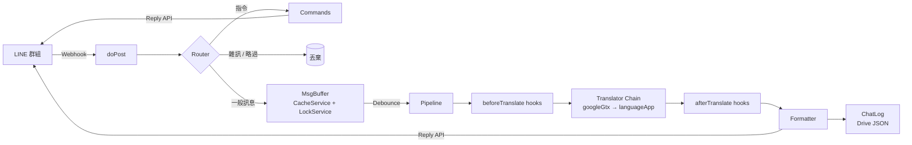

# akai-ito（赤い糸）

[English](README.md) | **繁體中文**

> 一個放在 LINE 群組裡的即時翻譯 bot，讓中文與日文使用者在同一個聊天室裡自然對話。


-F7DF1E)


---

## 目錄

- [概要](#概要)
- [功能](#功能)
- [系統架構](#系統架構)
- [專案結構](#專案結構)
- [開發環境](#開發環境)
- [快速開始](#快速開始)
- [設定](#設定)
- [群組指令](#群組指令)
- [擴充](#擴充)
- [已知限制](#已知限制)
- [隱私](#隱私)
- [Roadmap](#roadmap)

---

## 概要

akai-ito 是部署在 Google Apps Script 上的 LINE Messaging API bot。加入群組後，它會依照發話者的角色自動判斷翻譯方向（中文 ⇄ 日文），把一段時間內的連續訊息打包，一次翻譯並回覆。

設計上採取**第一人稱**：bot 是擁有者（owner）自己的溝通工具。綁定的使用者是 owner，群組內其他成員一律視為對話對象（partner）。

整個系統不需要付費 API 或自架伺服器，翻譯層則抽象成可替換的介面，之後可以無痛切換到自架 LLM。

## 功能

- **自動雙向翻譯**：owner 的訊息翻成日文，partner 的訊息翻成繁體中文。
- **訊息批次處理**：以 debounce 收集連續訊息，同一個人的連續發言合併成一段翻譯，減少聊天室裡的洗版。
- **只使用 Reply API**：不使用 Push API，不消耗官方帳號的訊息額度。
- **詞彙表**：常用短句與語氣詞直接查表翻譯；機器翻譯固定會犯的錯（稱謂、bot 名字、亂補的主詞）在翻譯後自動修正。
- **翻譯器備援鏈**：主要翻譯器失敗時，只把失敗的段落交給下一個翻譯器。
- **雜訊過濾**：貼圖、純 emoji、`www`、`笑` 等不翻譯；`!` 開頭的訊息可以手動略過。
- **群組白名單**：只服務綁定的那一個群組。
- **執行期調參**：等待時間可以用群組指令即時調整，不需要重新部署。
- **對話紀錄**：每次回覆後，把這一批翻譯（以及沒翻譯的訊息）連同延遲數據直接追加到 Google Drive 上的 JSON 檔，就是現成的資料集。

## 系統架構



### 訊息批次處理（Debounce）

Apps Script 沒有常駐程序，無法使用計時器。akai-ito 改用「由最後一則訊息負責送出」的策略：

1. 每則訊息進來時，在鎖內寫入共用暫存區，並取得一個遞增序號。
2. 該次執行等待 `quietMs`；如果最舊的訊息即將超過 `maxWaitMs`，等待時間會自動縮短。
3. 醒來後再上鎖檢查：
   - 如果自己仍是**最新的一則**，或**最舊的訊息已經等超過 `maxWaitMs`**，就取走整包訊息並清空暫存區，用自己的 reply token 回覆。
   - 否則直接結束，交給後續的執行處理。

這個流程保證：

| 性質 | 機制 |
|---|---|
| 不遺漏 | 所有讀寫都在 `LockService` 鎖內完成 |
| 不重複 | 取走與清空是同一個原子操作 |
| Reply token 不過期 | `maxWaitMs` 為等待上限，回覆一律使用送出者自己的新鮮 token |
| 不超過 Reply 限制 | 每次最多 5 則；超過時合併成單一訊息 |

### 併發模型

Apps Script 沒有執行緒。每個 webhook 請求是一個獨立、平行的執行，併發問題是用「共享狀態加鎖」來處理，而不是開執行緒。

- **LockService**：保護暫存區與上下文的讀寫。
- **CacheService**：存放暫存區與對話上下文，有 TTL，會自動過期。
- **PropertiesService**：存放綁定與設定這類需要持久保存的狀態。
- **UrlFetchApp.fetchAll**：同一批次裡的多個段落平行送出翻譯請求。

## 專案結構

```
akai-ito-bot/
├── README.md
├── README.zh-TW.md
├── package.json           # clasp 指令與開發相依套件
├── jsconfig.json          # 編輯器的 Apps Script 型別提示
├── .clasp.json.example    # 連結 Apps Script 專案的設定範本
└── src/                   # 原封不動推送到 Apps Script
    ├── appsscript.json    # Manifest：V8 執行環境、時區、網頁應用程式設定
    ├── Config.js          # 所有可調參數與執行期覆寫
    ├── Main.js            # Webhook 進入點、事件路由、debounce
    ├── Identity.js        # 角色判定、綁定、暫停狀態、授權輔助
    ├── Buffer.js          # 訊息暫存區與對話上下文（Cache + Lock）
    ├── Translators.js     # 翻譯器介面與實作、備援鏈
    ├── Glossary.js        # 短句表與翻譯後修正
    ├── Pipeline.js        # 分段 → hooks → 翻譯 → hooks → 排版
    ├── Commands.js        # 群組指令
    ├── ChatLog.js         # 對話紀錄（Drive 上的 JSON 檔）
    └── Line.js            # LINE Reply API client
```

## 開發環境

**不需要任何編譯器或建置步驟。** Apps Script 是在 Google 的 V8 執行環境上直接跑 JavaScript。`.gs` 只是網頁編輯器使用的副檔名；本機的檔案是 `.js`，由 [clasp](https://github.com/google/clasp) 上傳成伺服器端腳本。

### 需求

- [Node.js](https://nodejs.org/) 20 以上（建議 22 / 24 LTS）
- 一個已在 [script.google.com/home/usersettings](https://script.google.com/home/usersettings) **開啟 Apps Script API** 的 Google 帳號

### 安裝

```bash
npm install
npx clasp login
```

把本機資料夾連結到 Apps Script 專案：

1. 在 [script.google.com](https://script.google.com/) 建立一個新專案。
2. 在「專案設定」複製它的 **指令碼 ID（Script ID）**。
3. 把 `.clasp.json.example` 複製成 `.clasp.json`，填入 Script ID。

```bash
cp .clasp.json.example .clasp.json        # macOS / Linux
copy .clasp.json.example .clasp.json      # Windows
```

### 指令

| 指令 | 說明 |
|---|---|
| `npm run push` | 把 `src/` 推送到 Apps Script（包含 manifest） |
| `npm run watch` | 檔案一變動就自動推送 |
| `npm run status` | 列出會被推送的檔案 |
| `npm run open` | 在 Apps Script 編輯器中開啟專案 |
| `npm run deployments` | 列出部署 ID |
| `npm run redeploy -- <deploymentId>` | 把新版本發布到既有部署，網址不變 |

> `clasp push` 會**整個取代遠端專案**。請以 `src/` 為唯一來源，避免在網頁編輯器裡改程式碼。

## 快速開始

### 1. 建立 LINE Messaging API channel

1. 在 [LINE Developers Console](https://developers.line.biz/console/) 建立 Messaging API channel。
2. 發行 **long-lived channel access token**。
3. 在 [LINE Official Account Manager](https://manager.line.biz/) 調整設定：
   - 開啟「允許加入群組或多人聊天室」
   - 關閉「自動回應訊息」與「加入好友的歡迎訊息」
   - 開啟 Webhook，**並保持「Webhook 重送」為關閉**

### 2. 推送程式碼

1. 完成[開發環境](#開發環境)的設定，執行 `npm run push`。
2. 在 Apps Script 編輯器（`npm run open`）的「專案設定 → 指令碼屬性」新增 `CHANNEL_ACCESS_TOKEN`。
3. 選擇 `authorize` 函式並手動執行一次，完成權限授權。

### 3. 部署

1. 在編輯器選擇「部署 → 新增部署 → 網頁應用程式」（設定值來自 `appsscript.json`）：
   - 執行身分：**我**
   - 存取權：**所有人**
2. 把網頁應用程式的網址貼到 LINE Developers Console 的 Webhook URL。
3. 之後更新時，先 `npm run push`，再 `npm run redeploy -- <deploymentId>`。

### 4. 綁定

1. 建立一個群組，邀請對話對象與 bot。
2. owner 用**手機版 LINE** 在群組輸入 `/我是`。

## 設定

### `CONFIG`（`src/Config.js`）

| 鍵 | 預設值 | 說明 |
|---|---|---|
| `roles.owner` | `zh-TW → ja` | owner 的翻譯方向與標示 |
| `roles.partner` | `ja → zh-TW` | partner 的翻譯方向與標示 |
| `timing.quietMs` | `3000` | 最後一則訊息之後的靜默時間（毫秒） |
| `timing.maxWaitMs` | `8000` | 單一批次的最長等待時間（毫秒） |
| `translator.chain` | `['languageApp']` | 翻譯器的嘗試順序（從 Apps Script 連不到 `googleGtx`） |
| `glossary.enabled` | `true` | 啟用短句表與翻譯後修正 |
| `glossary.partnerAddress` | `'お姉ちゃん'` | owner 用日文怎麼稱呼 partner，姐姐／姊姊／你／妳 都會翻成這個 |
| `filter.skipPrefixes` | `['!', '！']` | 以這些字元開頭的訊息不翻譯 |
| `filter.noisePatterns` | — | 視為雜訊的正規表示式 |
| `reply.maxBubbles` | `5` | 單次回覆的訊息上限（LINE 規格） |
| `context.keep` | `20` | 保留的上下文段數 |
| `context.ttlSec` | `21600` | 上下文保存時間（秒） |
| `log.enabled` | `true` | 是否記錄對話到 JSON 紀錄檔 |
| `log.logSkipped` | `true` | 沒翻譯的訊息也記錄 |
| `log.folderName` | `akai-ito` | 紀錄檔所在的 Drive 資料夾 |
| `log.rotate` | `'month'` | `'month'`：每月一個檔；`'none'`：全部寫在同一個檔 |
| `testMode.directChat` | `true` | owner 與 bot 的 1 對 1 私聊也會翻譯，方向由文字判斷（單人測試用） |

### 指令碼屬性（Script Properties）

| 鍵 | 必要 | 說明 |
|---|---|---|
| `CHANNEL_ACCESS_TOKEN` | ✅ | LINE channel access token |
| `LLM_ENDPOINT` | — | 自架 LLM 翻譯服務的網址 |
| `OWNER_USER_ID` / `BOUND_CHAT_ID` | 自動 | 由 `/我是` 寫入 |
| `PAUSED` | 自動 | 由 `/暫停`、`/恢復` 寫入 |
| `TIMING_QUIET_MS` / `TIMING_MAX_WAIT_MS` | 自動 | 由 `/計時` 寫入，會覆寫 `CONFIG.timing` |
| `LOG_FILE_<period>` | 自動 | 各紀錄檔的 Drive 檔案 ID，第一次使用時自動建立 |

## 群組指令

| 指令 | 別名 | 說明 | 權限 |
|---|---|---|---|
| `/我是` | `/bind` | 綁定 owner 與目前的群組 | 首次任何人；之後僅 owner |
| `/暫停` | `/一時停止` `/pause` | 暫停翻譯 | 所有成員 |
| `/恢復` | `/再開` `/resume` | 恢復翻譯 | 所有成員 |
| `/說明` | `/ヘルプ` `/help` | 顯示中日雙語使用說明 | 所有成員 |
| `/狀態` | `/status` | 顯示狀態、翻譯器、計時參數 | 所有成員 |
| `/計時 <quiet> <max>` | `/timing` | 調整等待時間；`/計時 預設` 還原 | owner |
| `/重設` | `/reset` | 解除綁定 | owner |
| `/紀錄` | `/log` | 顯示目前紀錄檔的網址 | owner |

## 擴充

### 新增翻譯器

在 `TRANSLATORS` 加入一個實作 `translateBatch` 的物件，再把它的名稱加進 `CONFIG.translator.chain`。

```js
TRANSLATORS.myTranslator = {
  /**
   * @param {{text: string, from: string, to: string}[]} reqs
   * @param {{context: object[]}} opts
   * @returns {(string|null)[]}  與 reqs 等長；失敗的位置回傳 null
   */
  translateBatch(reqs, opts) { /* ... */ },
};
```

### 接上自架 LLM

內建的 `macMiniLlm` 翻譯器會呼叫 `LLM_ENDPOINT`，請求與回應格式如下：

```jsonc
// Request: POST LLM_ENDPOINT
{
  "items":   [{ "text": "今天好累", "from": "zh-TW", "to": "ja" }],
  "context": [{ "role": "partner", "text": "...", "translation": "..." }]
}

// Response: 200 OK
{ "translations": ["今日めっちゃ疲れた"] }
```

啟用方式：

```js
translator: { chain: ['macMiniLlm', 'googleGtx'] }
```

### 詞彙表

`src/Glossary.js` 裡的 `GLOSSARY` 分成兩部分：

- `phrases`：每個翻譯方向的 `[pattern, 譯文]`。一段訊息的每一行都命中時直接查表，不經過翻譯引擎。
- `rules`：翻譯後修正。只有**原文**符合 `ifSource`、且不符合 `unlessSource` 時才套用，不依賴特定翻譯引擎的輸出。`{partner}` 會換成 `glossary.partnerAddress`。

```js
{ dir: 'ja>zh-TW', ifSource: /イト/, replace: [[/伊藤|伊托/g, 'イト']] }
```

### Hooks

個人化、語氣調整、語感註解、附加讀音等功能，都可以寫成 hook 掛進 Pipeline，不需要修改主流程。

```js
// 簽名：(segments, context) => segments
HOOKS.afterTranslate.push((segments, ctx) => segments.map(s => ({ ...s /* ... */ })));
```

## 對話紀錄

每次回覆之後，這一批的紀錄會直接追加到 owner Google Drive 裡 `akai-ito` 資料夾的 JSON 檔。寫入發生在回覆**送出之後**，不會增加延遲。被判定為雜訊或以 `!` 開頭而略過的訊息也會記錄，讓資料集保有完整對話。紀錄不包含 userId，只記錄角色（`owner` / `partner`）。

- **檔案**：`akai-ito-log-YYYY-MM.json`，每月一個檔（把 `log.rotate` 設為 `'none'` 則全部寫在 `akai-ito-log.json`）。分月可以讓資料變多之後，每次讀寫仍然保持快速。
- **併發**：所有寫入都在 `LockService` 鎖內進行，平行執行不會互相覆蓋。
- **安全**：檔案內容無法解析時會中止寫入，不會覆蓋既有資料。

```jsonc
{
  "project": "akai-ito",
  "period": "2026-10",
  "created_at": "2026-10-17T13:00:00.000Z",
  "updated_at": "2026-10-17T13:05:12.000Z",
  "count": 2,
  "records": [
    {
      "logged_at": "2026-10-17T13:05:12.000Z",
      "batch_id": "6f1c…",
      "chat_type": "group",
      "role": "owner",
      "from": "zh-TW",
      "to": "ja",
      "source_text": "今天好累\n想吃拉麵",
      "translation": "今日は疲れた\nラーメンが食べたい",
      "ok": true,
      "translator": "googleGtx",
      "message_count": 2,
      "messages": [{ "text": "今天好累", "at": "…" }, { "text": "想吃拉麵", "at": "…" }],
      "wait_ms": 3104,
      "translate_ms": 412,
      "latency_ms": 3620,
      "status": "translated"
    }
  ]
}
```

| 欄位 | 說明 |
|---|---|
| `batch_id` | 同一次回覆的所有段落共用（略過的訊息為 `null`） |
| `messages` | 組成這一段的原始訊息與時間戳 |
| `wait_ms` | 第一則訊息 → 開始翻譯 |
| `translate_ms` | 翻譯花費時間 |
| `latency_ms` | 最後一則訊息 → 回覆送出（使用者實際感受的延遲） |
| `status` | `translated`、`failed`、`skipped:prefix`、`skipped:noise` |

在聊天室輸入 `/紀錄`，就會回傳目前紀錄檔的連結。

> 升級到含紀錄功能的版本後，請在編輯器重新執行一次 `authorize`，授予 Google Drive 的權限。

## 已知限制

- **無法驗證 webhook 簽章**：Apps Script 的 `doPost` 取不到 request header，因此無法驗證 `X-Line-Signature`。目前以群組白名單作為緩解措施。
- **userId 可能缺失**：部分用戶端不會附上 `userId`，此時改用「是否含有假名」判斷語言，純漢字的日文短句可能會誤判。
- **Webhook 驗證顯示錯誤**：Apps Script 會回傳 302 轉址，LINE Console 的「驗證」可能失敗，但實際收發通常不受影響。
- **非官方翻譯端點**：`googleGtx` 使用非公開的端點，沒有服務保證；`languageApp` 作為備援，但有每日配額。
- **延遲**：總延遲 ≈ `quietMs` + 翻譯時間，目前仍在調校。

## 隱私

- **對話會以 JSON 檔永久保存**在 owner 的 Google Drive（見[對話紀錄](#對話紀錄)）。把 `log.enabled` 設為 `false` 即可關閉。
- 訊息暫存區（最多 10 分鐘）與翻譯上下文（最多 6 小時）只存在 `CacheService`。
- 訊息會經過 LINE 平台與所設定的翻譯服務（目前為 Google 翻譯）。
- 部署前，請確認群組內所有成員都知情，並同意使用 bot 與對話紀錄。
- 下載到本機的紀錄檔已列入 `.gitignore`，請勿把對話資料提交到 repository。

## Roadmap

- [x] 以 `clasp` 管理部署
- [ ] 接上 Mac mini 自架 LLM（Cloudflare Tunnel）
- [ ] 運用上下文進行語氣與稱謂一致化
- [ ] 延遲最佳化（動態 debounce、串流回覆）
- [ ] 附加日文讀音（假名／羅馬拼音）的學習模式
- [ ] 語音訊息與圖片文字翻譯
- [x] 對話紀錄（JSON 資料集）

## 授權

[MIT](LICENSE) © 2026 Hsu Hao-Hsiang

---

Maintained by [@sam0418](https://github.com/sam0418)
